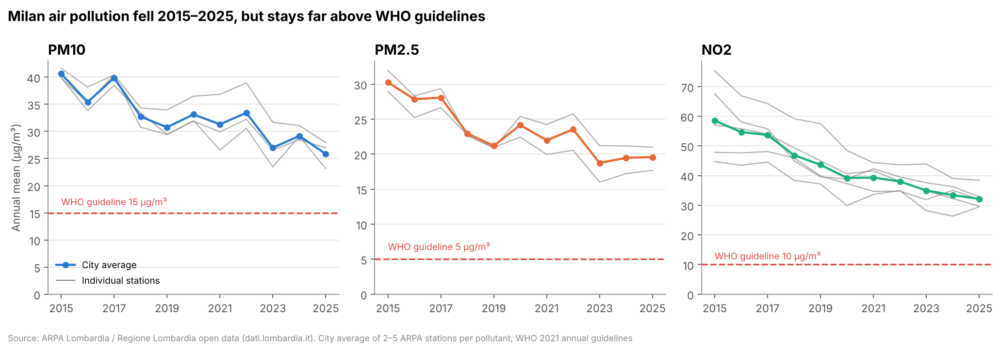
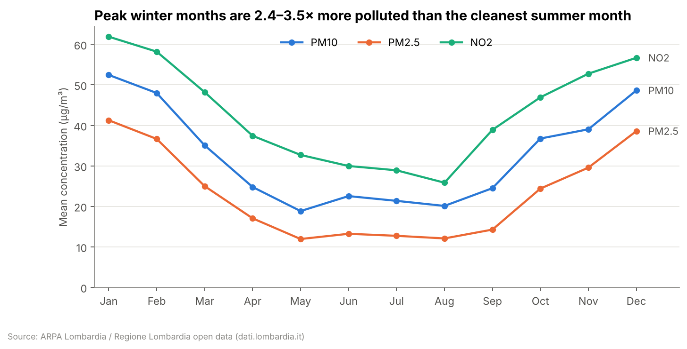
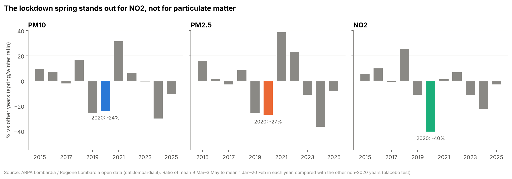
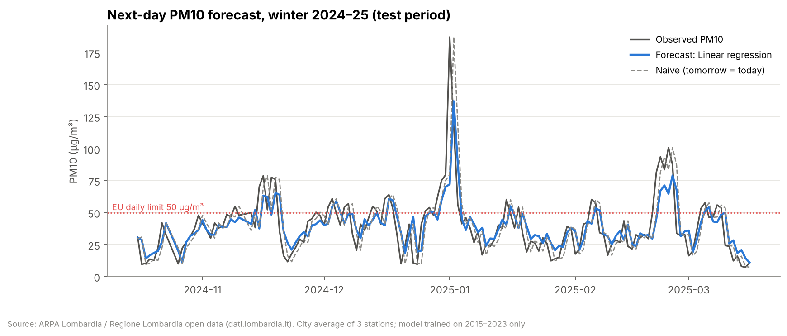

# Milan Air Quality: trends, seasonality and the 2020 lockdown effect

I analysed eleven years of official air quality measurements from Milan (2015–2025, plus 2026 to date) to answer four questions:

1. Is the air in Milan getting cleaner, and how fast?
2. When is it worst: which months, days and hours?
3. How much did the spring 2020 COVID lockdown change pollution, once you compare it fairly?
4. Can tomorrow's PM10 be predicted better than by assuming it will be the same as today?

All data comes from ARPA Lombardia's monitoring network, through the Regione Lombardia open data API. Every number below is produced by the notebooks in this repository.

## Key findings

**1. Pollution fell clearly from 2015 to 2025, but is still far above WHO guidelines.**
The annual mean of NO2 fell from 58.5 to 32.1 µg/m³ (−45%), PM10 from 40.6 to 25.9 (−36%) and PM2.5 from 30.3 to 19.6 (−35%). A robust Theil–Sen trend gives −2.6 µg/m³ per year for NO2 and about −1.1 to −1.3 for PM, all statistically consistent (Kendall p < 0.01). Even so, in 2025 the annual means were 1.7× (PM10), 3.9× (PM2.5) and 3.2× (NO2) the WHO 2021 guidelines. PM10 days above the legal EU limit of 50 µg/m³ fell from 91–101 per station in 2015 to 21–36 in 2025, but in no year did all three stations stay within the 35 days allowed.



**2. Winter and working days are the worst.**
In January, average PM2.5 is 3.5× the level of the cleanest summer month (PM10 2.8×, NO2 2.4×). This is the Po Valley's typical winter stagnation: weak wind, temperature inversions and heating emissions. NO2, which comes mostly from traffic, is 19% below its weekly average on Sundays and has a clear weekday morning rush-hour peak. PM has a weaker weekly cycle, because much of it forms in the air from other sources.



**3. The 2020 lockdown cut NO2 sharply, but did not clearly reduce particulate matter.**
I compared 9 March – 3 May 2020 with the same dates in other years in three increasingly strict ways:

| | NO2 | PM10 | PM2.5 |
|---|---|---|---|
| Naive: vs 2015–2019 average | −43% | −13% | −20% |
| Trend-adjusted: vs the 2015–2019 trend extended to 2020 | −29% | +13% | +27% |
| Ratio to the same year's Jan–Feb, vs all other years | −40% | −24% | −27% |
| Rank of 2020 among 11 years (1 = biggest drop) | **1st** | 3rd | 2nd |

For NO2, 2020 stands out in every comparison, and in the placebo test the next most extreme year is only −22%. For PM, 2019 and 2024, years without any lockdown, show similar or larger "drops", so the PM change in 2020 is within normal year-to-year variation. This is consistent with most Po Valley PM being secondary (formed from agricultural ammonia and other gases) or coming from heating, which the lockdown did not stop.

I also tested a hypothesis that turned out only partly right: I expected the morning rush-hour peak to collapse. In fact, on weekdays during the lockdown NO2 fell by about 30% in the morning peak, about as much as at night, while the largest drop was in the afternoon (−57% between 14:00 and 18:00).



**4. A simple model beats "tomorrow = today", but only modestly.**
Persistence ("tomorrow's PM10 = today's") is a strong baseline, with an MAE of 7.9 µg/m³ on 2024–2025. A linear regression on lagged pollution and calendar features, chosen by cross-validation, reduces the error by 8.9% (MAE 7.21 µg/m³; block-bootstrap 95% CI for the improvement 0.33–1.09 µg/m³). Gradient boosting (LightGBM) performed about the same as the linear model (within 0.15 µg/m³), so the extra complexity did not pay off with these features. The model's forecasts trail sudden spikes by about a day, because it has no weather information.



## How to run it

Requires Python 3.11.

```bash
python -m venv .venv
```

```bash
source .venv/bin/activate
```

```bash
pip install -r requirements.txt
```

```bash
python scripts/download_data.py
```

```bash
jupyter lab notebooks/
```

Run the notebooks in order (01 → 05). The download takes about a minute. Notebook 02 writes the cleaned files that the later notebooks read. To run the tests:

```bash
python -m pytest
```

## Repository structure

| Path | Content |
|---|---|
| `notebooks/01_data_collection.ipynb` | download, station selection, coverage |
| `notebooks/02_cleaning.ipynb` | validity flags, error codes, timestamps, daily means, completeness |
| `notebooks/03_eda_trends.ipynb` | trends, seasonal/weekly/daily cycles, WHO and EU comparison |
| `notebooks/04_lockdown_effect.ipynb` | lockdown analysis with placebo test |
| `notebooks/05_forecasting.ipynb` | next-day PM10 forecast |
| `src/` | reusable code: `fetch.py`, `clean.py`, `features.py`, `analysis.py`, `plotting.py`, `config.py` |
| `tests/` | pytest tests for cleaning and for leakage-free features |
| `scripts/download_data.py` | re-downloads the raw data (raw data is not committed) |
| `figures/` | charts used in this README |

## Data sources

- **Measurements:** ARPA Lombardia, published by Regione Lombardia on [dati.lombardia.it](https://www.dati.lombardia.it) (Socrata API, no key needed):
  - [`nr8w-tj77`](https://www.dati.lombardia.it/d/nr8w-tj77) Dati sensori aria 2010–2017
  - [`g2hp-ar79`](https://www.dati.lombardia.it/d/g2hp-ar79) Dati sensori aria dal 2018
  - [`nicp-bhqi`](https://www.dati.lombardia.it/d/nicp-bhqi) Dati sensori aria (current year, provisional)
- **Stations:** [`ib47-atvt`](https://www.dati.lombardia.it/d/ib47-atvt) Stazioni qualità dell'aria
- **Guidelines:** [WHO global air quality guidelines (2021)](https://www.who.int/publications/i/item/9789240034228); EU limits from Directive 2008/50/EC.

Stations used: PM10 at Verziere, v.Senato and Pascal Città Studi; PM2.5 at v.Senato and Pascal Città Studi; NO2 at those three plus v.Marche and v.Liguria. I kept only sensors active over the whole period, so the city average is not distorted by stations opening or closing.

## Methods

- **Cleaning.** Values flagged invalid by ARPA (`stato = NA`, always paired with the code `-9999`) become missing; negative, implausibly high and "stuck" values would too (none occur in this period). Hourly NO2 timestamps mark the *end* of the hour, so I shift them back by one hour. A daily NO2 mean needs at least 18 valid hours (the EU 75% rule), and a city-wide daily value needs at least 2 stations. Gaps are never filled in.
- **Trends.** Annual means (only years with ≥ 75% valid days), Theil–Sen slope with Kendall's tau test, and STL decomposition of monthly means to separate trend from seasonality.
- **Lockdown.** Same-calendar-window comparisons: naive, trend-adjusted, and a ratio to each year's own January–February (a difference-in-differences idea that removes year-level effects such as the long-term trend), with a placebo test over all 11 years.
- **Forecast.** Leakage-free features (tested), a strictly chronological split (train 2015–2022, model selection with calendar-year expanding-window CV and 2023, single final test on 2024–2025, extra check on 2026), a persistence baseline, MAE as the main metric, and a 7-day block bootstrap for uncertainty.

## Limitations

- **Station coverage.** "Milan" means the average of 2–5 urban stations, depending on the pollutant. PM2.5 has only two stations, so about 11% of days have no city value.
- **No weather data.** Weather drives much of the day-to-day and year-to-year variation. It is the main confounder in the lockdown analysis and the main missing input for the forecast.
- **Correlation, not proven causation.** The lockdown comparison shows that spring 2020 was unusual for NO2, more than ordinary differences between years. It does not observe what would have happened without a lockdown, so it is strong evidence, not a causal proof. Behaviour also changed gradually from late February, so the window boundaries are an approximation.
- **Provisional 2026 data.** Current-year values may still be revised by ARPA, so 2026 is used only as an extra forecast check.
- **Fixed clock.** ARPA timestamps do not follow daylight saving (UTC+1 all year), so summer hourly patterns appear one hour earlier than on the wall clock.

## What I would do next

Add ARPA weather data (wind, precipitation, temperature, and boundary-layer height if available) to (a) build a "de-weathered" business-as-usual model for the lockdown counterfactual and (b) improve the forecast, especially for the sudden winter episodes it currently misses.
